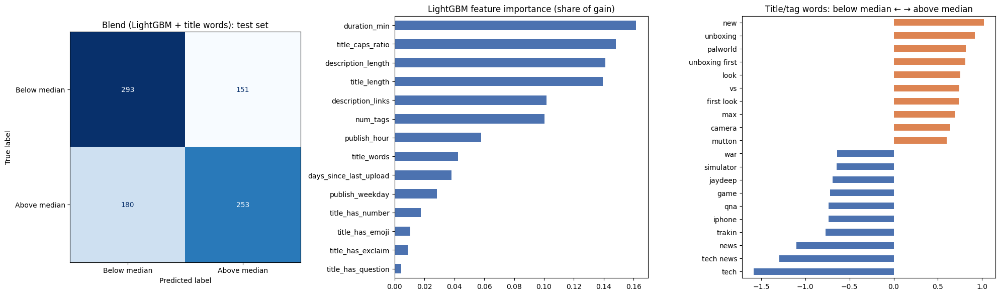
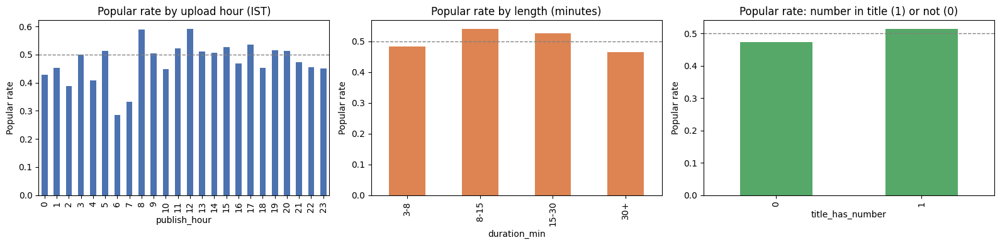

# YouTube Video Popularity Prediction

Can a video's title, length and upload time predict whether it will beat its channel's usual views?
Data collected with the official YouTube Data API from 30 popular Indian channels, modeled with logistic regression, LightGBM and the words in each title (TF-IDF).

Results on the newest quarter (held-out test set):

| Model | Accuracy | ROC-AUC |
|---|---|---|
| Baseline (always one class) | 0.506 | 0.500 |
| Logistic regression | 0.536 | 0.538 |
| LightGBM (14 numeric features) | 0.580 | 0.650 |
| Title words (TF-IDF) | 0.611 | 0.655 |
| **Blend: LightGBM + title words** (chosen on validation) | **0.623** | **0.677** |

**Short answer:** partly. Upload-time information carries a real but modest signal: 62% accuracy vs 51% for guessing. The **topic** (title words) matters most; much of a video's success comes from things metadata doesn't capture, like the thumbnail.



---

## Problem

Predicting raw view counts mostly teaches a model that big channels get more views. This project asks a fairer question:

> **Did this video get more views than the same channel's other videos from the same quarter?**

`popular = 1` if yes, `0` if no. Each video is compared only with its own channel, so channel size drops out, and only with videos from the same 3-month period, so video age drops out.

## Pipeline

| Notebook | What it does |
|---|---|
| [`01_data_collection.ipynb`](01_data_collection.ipynb) | Collects 8,574 videos from 30 channels with the YouTube Data API (~350 quota units) |
| [`02_features.ipynb`](02_features.ipynb) | Filters comparable videos, defines the target, builds upload-time features, explores the data |
| [`03_model.ipynb`](03_model.ipynb) | Train / validation / test split by time, five models, model choice on validation, final test, leakage check |

## Approach

**Data.** 30 popular Indian channels across gaming, food, tech, education, music and entertainment (Technical Guruji, Apna College, CampusX, MortaL, T-Series, ...), newest 300 videos per channel.

**Cleaning.** Kept long-form videos (over 3 minutes) published 30 days to 2 years before collection; removed livestreams and channels with too few videos. Result: **4,221 videos from 27 channels.**

**Features (14).** Only information known at upload time:
- Title: length, word count, share of capital letters, contains a number / question mark / exclamation mark / emoji
- Video: length in minutes, number of tags, description length, links in the description
- Timing: upload hour and weekday (IST), days since the channel's previous video

Plus the **words in the title and tags**, turned into numbers with TF-IDF (rare, specific words count more than common ones).

Likes, comments and views are never used as features: they happen *after* upload, so using them would be data leakage.

**Models.** Baseline → logistic regression → LightGBM (numeric features) → logistic regression on title words (TF-IDF) → blend (average of LightGBM and title words).

**Validation.** Split by time, on quarter boundaries:

| Set | Quarters | Videos | Used for |
|---|---|---|---|
| Train | 2024 Q4 – 2026 Q1 | 2,498 | fitting |
| Validation | 2026 Q2 | 846 | choosing the model |
| Test | 2026 Q3 | 877 | final score, evaluated once |

A random split would let the model learn from future videos; choosing the model on the test set would make its score optimistic.

## Results

- **The blend was chosen on validation (ROC-AUC 0.669) and confirmed on test (0.677, accuracy 62.3%).**
- **No leakage:** trained on shuffled labels, the same model scores ROC-AUC ~0.5.
- **Words beat title statistics.** Title/tag words alone outperform the 14 numeric features, because they capture the topic.
- **Topic patterns:** new-product videos ("unboxing", "first look", "new", "vs", "camera") beat their channel's usual views; routine formats ("tech news", "news", "Q&A") fall below.
- **Most useful numeric features:** video length, share of capital letters in the title, description and title length.
- When the model predicts "popular" it is right 63% of the time, and it finds 58% of the popular videos.

### What the data shows



- Videos uploaded **2–7 AM IST** beat their channel's median only **44%** of the time (vs ~50% at other hours).
- **8–30 minute** videos do slightly better (~53%) than 3–8 minute or 30+ minute videos (~47%).
- Titles **with a number** ("Top 10…", "₹500 vs ₹5000"): 51.5% popular vs 47.2% without.

Every effect is only a few percentage points.

## What I learned

- **Define the target carefully.** My first target (`views > channel median`) labeled 61% of 1–2-year-old videos "popular" but only 38–46% of newer ones: older videos simply had more time to collect views. Comparing videos within the same quarter fixed it: every age group is now ~49% popular (shown in `02_features.ipynb`).
- **Leakage isn't always a column.** Likes and comments are obvious leaks; comparing a video with *future* videos when defining the label is a subtler one.
- **Choose on validation, report on test.** Picking the best model by its test score would quietly overfit the test set.
- **Modest and honest beats impressive and wrong.** Adding likes would push accuracy far higher, and make the model useless for a video that hasn't been uploaded yet.
- **Plan around API limits.** Reading each channel's uploads playlist costs ~100× less quota than searching.

## Limitations & future work

- **No thumbnails**, probably the biggest driver of clicks. Next step: image features from thumbnails.
- **Simple text model.** TF-IDF only sees which words appear; pretrained text embeddings could capture meaning.
- **Mixed niches** and only 27 channels; more channels per niche would allow niche-specific models.
- View counts are a snapshot from one day; recent videos are still growing (videos under 30 days old were excluded).

## How to run

```bash
git clone https://github.com/omshivbhosale/youtube-popularity.git
cd youtube-popularity
pip install -r requirements.txt
```

1. Create a YouTube Data API v3 key in [Google Cloud Console](https://console.cloud.google.com/) (APIs & Services → Library → YouTube Data API v3 → Enable, then Credentials → Create API key).
2. Create a file named `.env` in the project folder:
   ```
   YOUTUBE_API_KEY=your_key_here
   ```
3. Run the notebooks in order. The collected data (`videos_raw.csv`, `channels.csv`) is included, so you can skip notebook 01 and start at `02_features.ipynb` without an API key.

On macOS, LightGBM needs OpenMP: `brew install libomp`.

## Project structure

```
├── 01_data_collection.ipynb
├── 02_features.ipynb
├── 03_model.ipynb
├── channels.csv            # 30 channels: name, subscribers, uploads playlist
├── videos_raw.csv          # 8,574 videos as returned by the API
├── videos_features.csv     # 4,221 cleaned videos with target and features
├── images/                 # charts used in this README
├── requirements.txt
└── .gitignore              # keeps .env (the API key) out of git
```

## Data

Some creators paste code, including API keys, into their video descriptions. Anything that looks like a secret is replaced with `[REDACTED]` before the data is saved (see `01_data_collection.ipynb`).

Collected with the [YouTube Data API v3](https://developers.google.com/youtube/v3) in October 2026 for educational purposes, in line with the [YouTube API Services Terms](https://developers.google.com/youtube/terms/api-services-terms-of-service).
